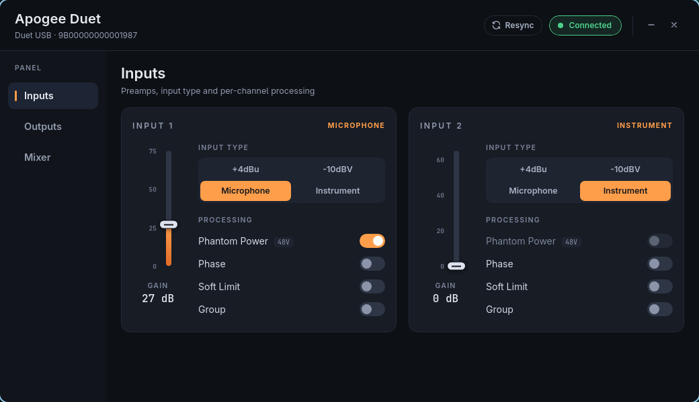
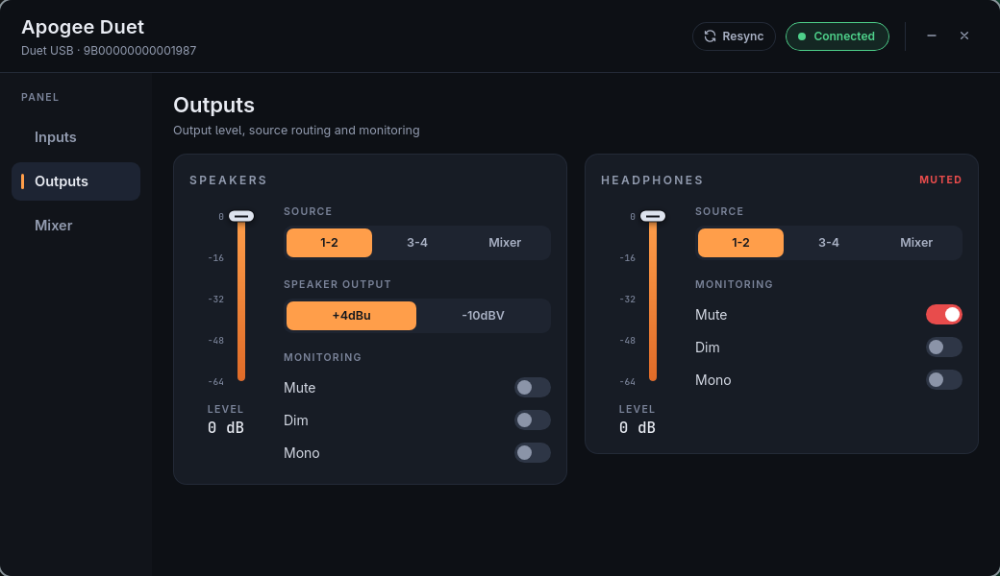
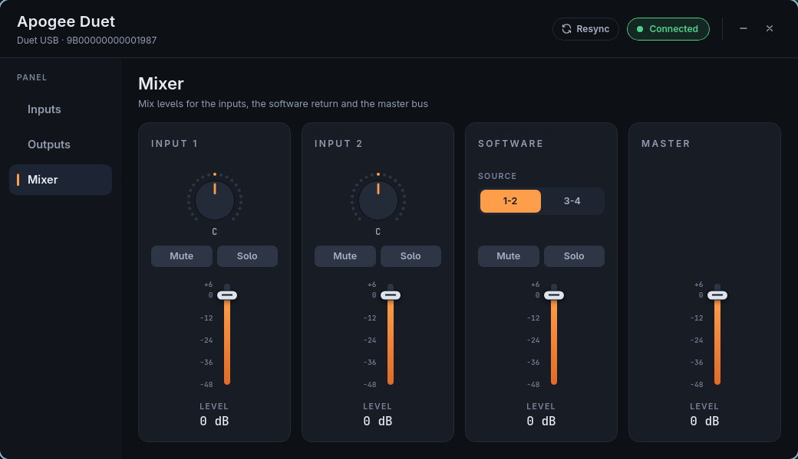

Control your Apogee Duet (USB) on Linux!
===

The interface works great out of the box using ALSA for recording and playing. However, there is no official way to control the settings like on macOS — this project speaks directly to the device over USB control transfers and wraps it in a modern, dark-themed control panel built with Rust and Tauri.





Features
---
- **Inputs**: gain faders with exact dB readouts, input type selection (+4dBu / -10dBV / Microphone / Instrument), phantom power, phase, soft limit and grouping. Line-level inputs correctly disable the gain control, since they bypass the preamp.
- **Outputs**: speaker and headphone levels with mute, dim, mono, output source and speaker reference level.
- **Mixer**: per-channel level, pan (double-click to recentre), mute and solo for both inputs, the software return and the master bus.
- Every control talks to the device immediately; fader drags are coalesced into at most one write per control every 60 ms, so the UI stays fluid without flooding the USB bus. Faders and knobs also follow the mouse wheel (Shift for coarse steps) and the keyboard.
- Output levels, output mutes and the input gain are read back every second, so changes made with the front knob or the system mixer show up in the panel.
- Failed USB control transfers are retried once automatically (the Duet drops roughly one transfer in a thousand).
- Offline page when no Duet is attached; the panel reconnects on its own once it is plugged in.

System volume
---
The speaker level and mute are also exposed by the kernel as the USB Audio Class control `Output Volume Control` (−64 to 0 dB, 1:1 with the panel's speaker fader):

```sh
amixer -c USB sset 'Output Volume Control' -- -12dB
```

The headphone level has no USB Audio Class control and can only be changed through this panel or the front knob.

Install
---
On Arch Linux, the `dsr-apogee-control-git` package from the [dsr-aur](https://github.com/quantmind-br/dsr-aur) repository installs the panel, its launcher entry and the udev rule:

```sh
sudo pacman -Syu dsr-apogee-control-git
```

Build from source
---
Requirements: Rust (1.85 or newer), WebKitGTK 4.1, GTK 3 and libusb.

```sh
# Arch Linux
sudo pacman -S --needed rust webkit2gtk-4.1 gtk3 libusb

# Ubuntu / Debian
sudo apt install cargo libwebkit2gtk-4.1-dev libgtk-3-dev libusb-1.0-0-dev
```

```sh
cd src-tauri
cargo build --release --features tauri/custom-protocol
./target/release/apogee-control
```

The frontend in `ui/` is plain HTML, CSS and JavaScript, so there is no Node.js step. `cargo tauri dev` runs the panel with the web inspector enabled.

Tests: `cargo test` runs the protocol unit tests; `cargo test -- --ignored` also runs a round trip against an attached Duet (it nudges the headphone level by 1 dB and restores it).

USB access without sudo
---
Running as root is not recommended. Install the udev rule shipped in `packaging/linux`, which grants the logged-in user access to the device:

```sh
sudo install -Dm644 packaging/linux/70-apogee-duet.rules /etc/udev/rules.d/70-apogee-duet.rules
sudo udevadm control --reload-rules
```

Unplug and replug the Duet (or run `sudo udevadm trigger`).

Things to improve
---
1. Add support for changing the assigned functions of the touchpads.

Credits
---
Forked from [fdgonthier/apogee-control](https://github.com/fdgonthier/apogee-control), with the protocol layer hardened and the panel rewritten in Rust and Tauri.
